<p align="center">
  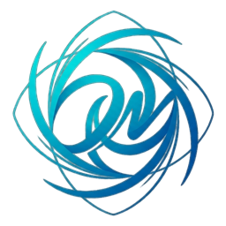
</p>

<h1 align="center">OmniMotion</h1>

<p align="center">
  A desktop editor that turns a raw talking-head clip into a finished short-form video (Reels, TikTok, Shorts):<br/>
  silences cut, word-timed captions, motion graphics, zooms, transitions, sound design and loudness, all from your own words.
</p>

<p align="center">
  
  <br/><sub>Frames from real edits: the built-in Tech look (left) and a paper scrapbook style built on the same engine (right).</sub>
</p>

---

## What it does

- **Cuts the pauses, never the words.** Pauses longer than about 0.35 s are shortened; every spoken word stays.
- **Transcribes mixed languages.** Arabic (including Tunisian), French and English in one sentence, with ElevenLabs Scribe or offline with Whisper.
- **Plans the edit from what you say.** Every caption, card, chart and motion graphic is anchored to a spoken word, so on-screen text always comes from your speech or your own files.
- **Agent build: recreate any reference.** Give it a reel whose editing you love. Claude studies it frame by frame and builds your edit from scratch in the same style (captions, layouts, cards, transitions, motion graphics), even designs the built-in looks don't have. It renders test frames and fixes overlaps and anything covering your face. You get a live preview you can change in plain words (with undo) and render when you're happy.
- **Motion graphics mode: a video from just an idea.** No camera needed. Describe the video, Claude writes a script sized to the length you pick (30, 45 or 60 s), ElevenLabs reads it with the voice you choose, and Claude animates every frame to the voice-over with Remotion, following the onetake motion-design method. You get a live preview with the final sound mix, change it in plain words, move elements on a timeline, and render.
- **Free models, built in.** Use Claude only, free models only, or Claude first and free models when your Claude limit is reached (the same job continues). The free model gateway ([FreeLLMAPI](https://github.com/tashfeenahmed/freellmapi)) runs inside OmniMotion: nothing to install, you only paste the free keys you get from providers like Groq or Google AI Studio.
- **Memory.** OmniMotion remembers what was settled for each project (the changes you asked for and what was done, undos, spelling fixes, builds) plus a note you write about yourself, and gives it to Claude at the start of every job, so it does not ask again or redo work. No extra AI calls.
- **Analyze any reel.** Paste a YouTube, Instagram or TikTok link (or pick a file): OmniMotion downloads it with yt-dlp and reports its hook, structure, colours, transitions, animations, motion graphics and tone of voice, with what to take for your own videos. Turn it into a look in one click.
- **Plan with Claude.** Optionally let Claude (through Claude Code or an API key) write the plan, or change it in plain words: *"remove the last graphic"*, *"zoom in when I say Greece"*. Every change can be undone.
- **Looks.** Colours, fonts and picture grade on a dark or paper stage. Build your own from scratch, from a description, or from a reference video.
- **Finishes the sound.** Royalty-free music that ducks under your voice, sound effects on every visual event, and a mix to -14 LUFS (true peak under -1 dBTP), the level Instagram, TikTok and YouTube expect.
- **Live preview.** A Remotion player shows the exact composition that gets rendered, with its sound.
- **Fine control.** Edit any caption's words on the timeline, pick caption colours, set the music volume (your voice always stays on top), and see the platform safe zones on the preview.

## Screenshots

| Projects | Media |
|---|---|
|  |  |
| **Story** (transcribe and cut) | **Plan** (timeline anchored to words) |
| 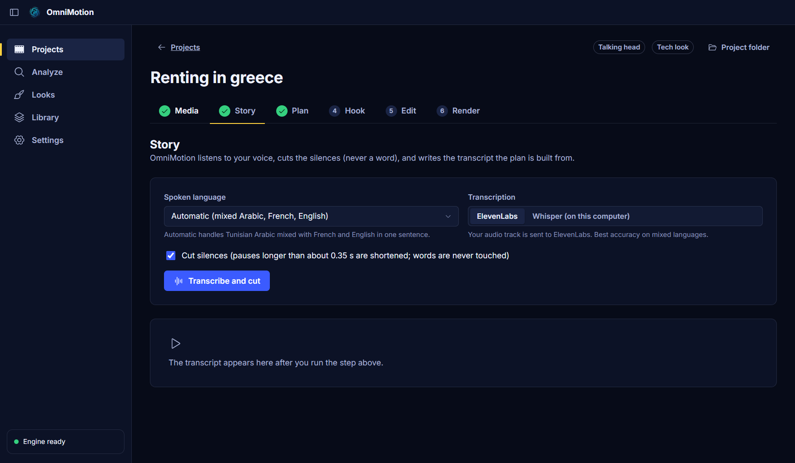 |  |
| **Edit** (change the plan in plain words) | **Render** |
| 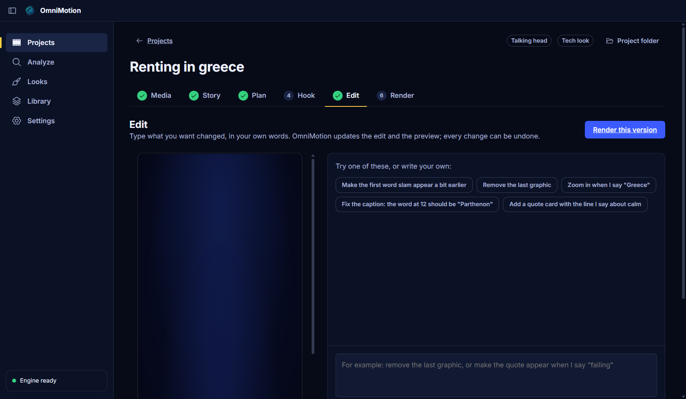 | 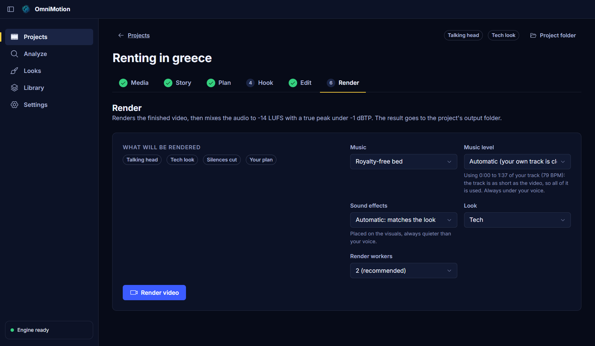 |
| **Looks** | **Settings** |
|  |  |

**Agent build**: a reference recreated by Claude, with a live preview and changes in plain words (with undo).

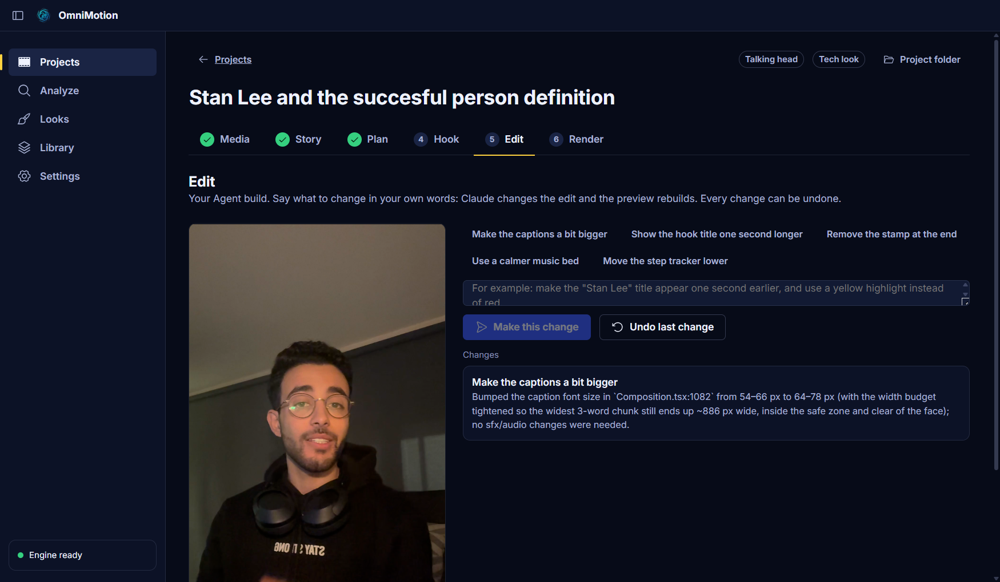

**Motion graphics mode**: from an idea to an animated, narrated video (Brief, Script, Voice, then Build, Edit and Render).

| **Brief** (idea, style, format, length) | **Script** (what Claude understood, editable lines) |
|---|---|
| 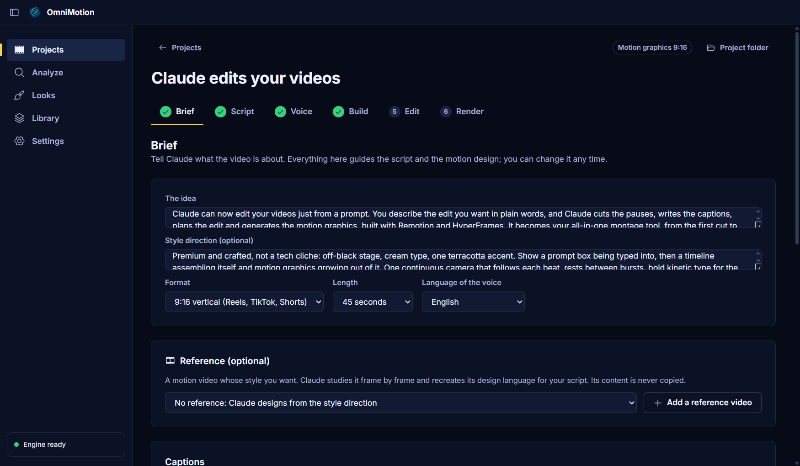 | 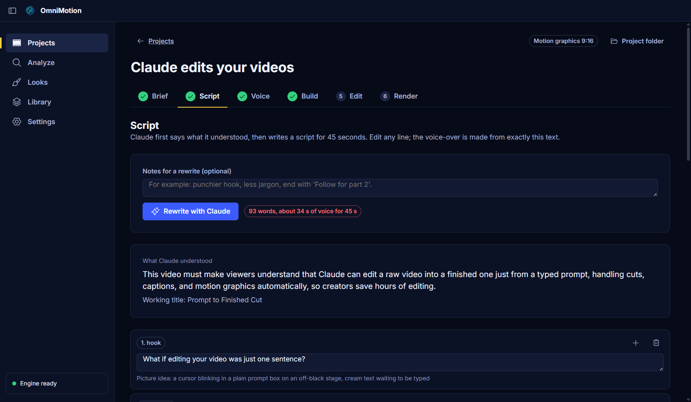 |
| **Voice** (ElevenLabs voices, speed, delivery) | **Edit** (live preview with sound, changes in plain words, timeline) |
| 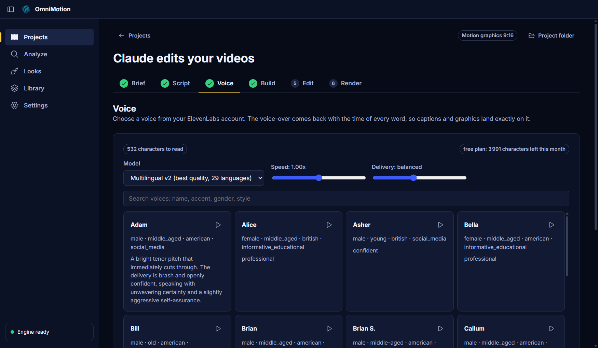 | 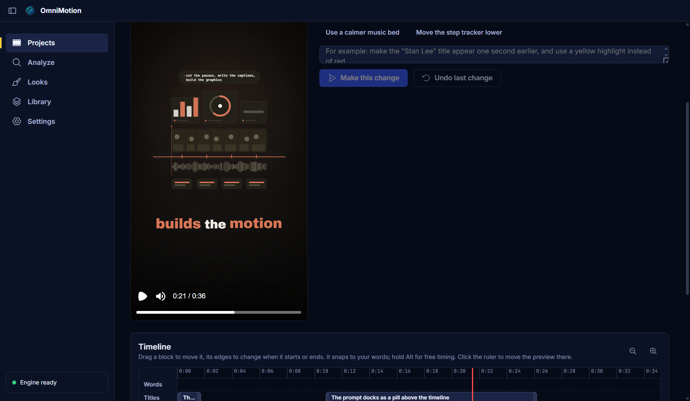 |

**Free models**: the built-in gateway, with a "Get a free key" link and a short guide for each provider.

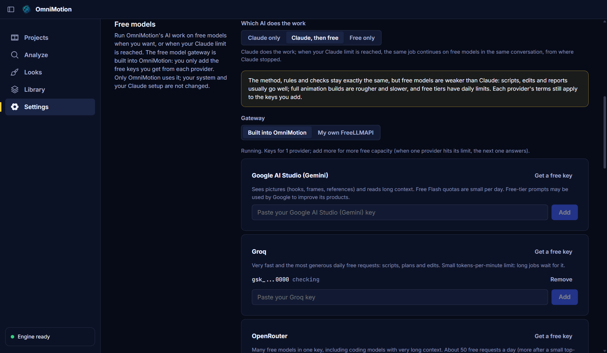

**Analyze**: paste a link to study a reel's hook, style and voice.

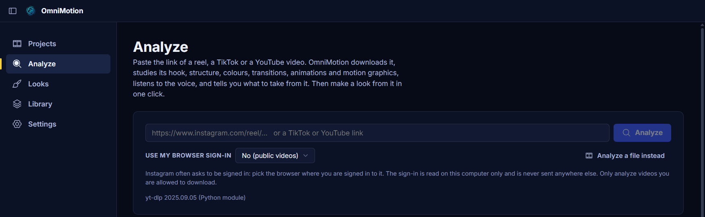

---

## Install

### Option A: Windows installer (easiest)

1. Open the [**Releases**](../../releases) page and download `OmniMotion-Setup-0.1.0.exe`.
2. Run it. Windows SmartScreen may warn because the app is not code-signed yet: click **More info → Run anyway**.
3. Start **OmniMotion** from the desktop shortcut.

The installer already contains the editing engine and FFmpeg, so nothing else is required. Then do the [first-run setup](#first-run-setup).

### Option B: run from source (Windows, macOS, Linux)

**You need**

| Tool | Version | Why |
|---|---|---|
| [Node.js](https://nodejs.org) | 20.19+ or 22.13+ (24 works) | runs the app and the engine |
| [FFmpeg](https://ffmpeg.org/download.html) | any recent full build, on your `PATH` | cutting, mixing, loudness |
| [Git](https://git-scm.com) | any | to clone the repo |
| Google Chrome or Microsoft Edge | any | screenshots of web pages used as graphics (optional) |

Check FFmpeg is found:

```bash
ffmpeg -version
```

**1. Clone**

```bash
git clone https://github.com/Mjawadi2002/OmniMotion.git
cd OmniMotion
```

The two folders must stay side by side: the app (`cutline-app/`) looks for the engine in `../video-studio`.

**2. Install the engine**

```bash
cd video-studio
npm install
cd ..
```

**3. Install and start the app**

```bash
cd cutline-app
npm install
npm start
```

`npm start` builds the interface and opens the window. For development with hot reload use `npm run dev`.

**4. (Optional) Build your own installer**

```bash
cd cutline-app
npm run dist
```

The installer lands in `cutline-app/release/`. It packs the engine and the FFmpeg it finds on your `PATH` (or in the folder set in `OMNIMOTION_FFMPEG_DIR`).

---

## First-run setup

Open **Settings** in the app.

1. **Engine**: should show *Engine ready*. If not, point it at the `video-studio` folder.
2. **Transcription** (pick one):
   - **ElevenLabs** (best for mixed Arabic / French / English): paste your API key. It is stored in your operating system's secure storage, never in a project file.
   - **Whisper (offline, free)**: download the model once from the `video-studio` folder:
     ```bash
     cd video-studio
     node -e "const w=require('@remotion/install-whisper-cpp');(async()=>{await w.installWhisperCpp({to:'whisper.cpp',version:'1.5.5'});await w.downloadWhisperModel({model:'small',folder:'whisper.cpp'});})()"
     ```
3. **Claude** (optional, for *Plan with Claude*, the Edit tab, Looks from references, Agent build and Motion graphics mode):
   - **Claude account**: install [Claude Code](https://docs.claude.com/en/docs/claude-code) and sign in once; OmniMotion uses it with your own account.
   - **API key**: paste an Anthropic API key.
   - **Off**: the automatic planner still works without AI.
4. **ElevenLabs voices** (Motion graphics mode): the same ElevenLabs key also gives you its voices for the voice-over; the free plan includes 10,000 characters a month.
5. **Free models** (optional): in **Settings → Free models**, choose *Claude, then free* or *Free only*, keep the gateway on *Built into OmniMotion*, click **Get a free key** next to a provider, and paste the key. See [Use free models](#use-free-models).
6. **yt-dlp** (Analyze page, links only): the page offers to install the official yt-dlp for you, or uses one already on your computer.
7. **Pop-out head** (optional, light looks): needs Python 3 with `pip install onnxruntime pillow numpy` and the `u2net_human_seg.onnx` model (from the [rembg releases](https://github.com/danielgatis/rembg/releases)) saved as `video-studio/models/u2net_human_seg.onnx`.

## How to edit a video

1. **Projects → New project**: choose *Talking head* or *Vlog*, and a look.
2. **Media**: drop your raw clip. Add logos, screenshots, extra clips, music or reference videos if you have them. Files are copied into the project; your originals are never changed.
3. **Story**: click **Transcribe and cut**. You get the transcript with timestamps and the silence cuts.
4. **Plan**: click **Automatic plan**, or describe what you want and click **Plan with Claude**. Drag blocks on the timeline; they snap to your words.
5. **Edit** (optional): type changes in plain words and watch the preview rebuild.
6. **Render**: pick music, sound effects and look, then **Render video**. The video and an edit report land in the project's `output/` folder.

### Recreate a reference with Agent build

When you want an edit that looks like a specific reel (not one of the built-in looks):

1. In **Media**, attach the reference video under *References* (or add it to the **Library**).
2. Run **Story** so your footage is transcribed and the pauses are cut.
3. In **Plan**, find **Recreate a reference (Agent build)**, choose the reference, add notes if you like (*"keep my original colours"*, *"end with a Follow card"*), and click **Build with Claude**.
4. Claude studies the reference, writes a composition for your video, renders test frames and fixes what is wrong (up to three rounds). You get a **live preview** in the card.
5. Open **Edit** to change anything in your own words (*"make the captions bigger"*, *"remove the stamp at the end"*). Claude changes the edit, the preview rebuilds, and every change can be undone.
6. Open **Render** to render it at 1080x1920 and mix voice, music and sound effects to -14 LUFS. To go back to the regular plan, click *Use the regular plan instead* in the Plan card.

Building takes 10 to 30 minutes and needs **Claude Code** connected with your Claude account (Settings → Claude → Claude account); it uses your Claude plan. Claude only gets file tools inside the project's own workspace folder: no shell commands, no network.

### Make a motion graphics video (no footage)

1. **Projects → New project → Motion graphics**: choose the format (9:16 or 16:9) and the length (30, 45 or 60 s).
2. **Brief**: describe the idea in your own words, add a style direction if you like, choose the language and the caption style. Optionally pick a reference video whose motion design you want.
3. **Script**: Claude says in one line what it understood, then writes the script to the right length. Edit any line, or ask for a rewrite with notes.
4. **Voice**: either listen to the voices of your ElevenLabs account, pick one and record (speed and delivery adjustable), or choose **My own recording** and give it an audio file you recorded: it is transcribed with the time of every word (Tunisian, Arabic, French, English and more are detected on their own) and its transcript becomes the script, so the video follows exactly what you say.
5. **Build**: choose **Fast** (Sonnet, 16 frames of the reference, one check round) or **Best quality** (Opus, every frame, up to three rounds). Claude picks a concept and animates every frame to the voice, renders check frames and fixes what is wrong (up to three rounds), then you get a **live preview with the final sound mix**. If Claude stops part way (for example your usage limit or an expired sign-in), the work is kept and **Finish the checks** picks up exactly where it stopped.
6. **Edit** and **Render**: as in Agent build, change it in plain words or on the timeline, then render to 1080x1920 (or 1920x1080) at -14 LUFS.

Example idea: *"A 45-second vertical video about HR management: teams still run on spreadsheets and email, then one platform brings hiring, onboarding, leave, payroll and reviews into one dashboard. End with Book a demo."*

### Use free models

The gateway that serves free models is built into OmniMotion (it starts on its own when needed, on this computer only, and stops when you quit). You bring the free keys:

| Provider | Good for | Free allowance (check your account; providers change it often) |
|---|---|---|
| [Groq](https://console.groq.com/keys) | very fast scripts, plans and edits | the most generous daily requests, small tokens per minute |
| [Google AI Studio](https://aistudio.google.com/apikey) (Gemini) | sees pictures (hooks, frames, references), long context | small daily quotas on Flash models; free-tier prompts may be used by Google |
| [OpenRouter](https://openrouter.ai/keys) | many free models with one key, incl. coding models | about 50 requests a day |
| [Mistral](https://console.mistral.ai/api-keys/) | Codestral / Devstral (code) | free experiment tier |
| [Z.ai](https://z.ai/manage-apikey/apikey-list) (GLM) | free Flash models, one sees pictures | free Flash models |
| [NVIDIA NIM](https://build.nvidia.com/settings/api-keys) | several large open models | free access |

Add more than one: when a provider hits its limit, the next one answers. The modes:

- **Claude only**: everything uses your Claude plan.
- **Claude, then free**: when your Claude limit is reached, the same job continues on free models, in the same conversation, from where Claude stopped.
- **Free only**: never uses your Claude plan.

The method, rules and checks are the same either way, but free models are weaker than Claude: scripts, edits and reports usually go well, full animation builds are rougher and slower. Free mode still uses Claude Code as the agent that does the work, so install it from Settings (no Claude sign-in is needed for free models). Each provider's terms apply to the keys you add.

### Analyze a reel

Open **Analyze**, paste the link of one video (or click *Analyze a file instead*) and click **Analyze**. For Instagram you may need *Use my browser sign-in* (the browser where you are signed in). You get the hook with a score and a reusable template, the structure, the theme and colours, the voice (pitch, energy, pace, pauses), the editing and motion, what to take, a script template and a style sheet. **Make a look from it** turns it into a look; **Add to Library** keeps the video as a reference. Only analyze videos you are allowed to download.

## Project layout

```
cutline-app/        the desktop app (Electron + React + Remotion Player)
  electron/         main process: projects, engine runner, media server, AI planning
  src/              interface: screens, design tokens, live preview
video-studio/       the editing engine
  .claude/skills/edit-style/
    scripts/        director.mjs (prepare, plan, render), agent.mjs (Agent build and Motion graphics), transcription, assets, sound design
    remotion/       the Remotion compositions that draw the video
    docs/           plan schema, motion graphics and sound design guides
    agent/          templates for Claude's compositions, and the onetake method (agent/onetake, noncommercial license)
cutline-app/resources/freellmapi/   the built-in free model gateway (FreeLLMAPI, MIT), made by scripts/bundle-freellm.mjs
    assets/cc0/     CC0 music and sound effects (sources in THIRD_PARTY.md)
docs/               screenshots and images for this README
```

Command-line use of the engine (without the app) is documented in `video-studio/.claude/skills/edit-style/docs/DIRECTOR.md`.

## Troubleshooting

- **"Engine not found"**: keep `cutline-app` and `video-studio` in the same parent folder, or set the engine path in Settings.
- **FFmpeg errors** about a missing filter: install a full FFmpeg build (the one bundled inside Remotion lacks some filters).
- **No transcription key**: without an ElevenLabs key the engine falls back to Whisper; install the Whisper model as shown above.
- **Free models answer "no provider key"**: add at least one free key in Settings → Free models. A Google key starts with `AIza`; a Groq key starts with `gsk_`.
- **"Claude is signed out"** during a build: sign in again in Settings (Claude), then click **Finish the checks** on the Build screen.
- **No sound in a preview made with an older version**: change anything, or click *Finish the checks* once; previews now carry the final mix.
- **Render is slow**: lower *Render workers* in the Render tab if your computer struggles, raise it on a strong CPU.

## Privacy and security

- API keys are encrypted with your OS keychain and never written into a project or this repo.
- Media is served to the window from a local server bound to `127.0.0.1` with a per-launch token.
- When ElevenLabs is selected, only the 16 kHz audio track is uploaded for transcription. Whisper runs fully offline. In Motion graphics mode the script text is sent to ElevenLabs to make the voice-over.
- In Agent build and Motion graphics mode Claude only gets file tools inside the project's workspace folder: no shell commands, no network.
- Free models: the gateway runs inside OmniMotion on `127.0.0.1` only. The provider keys you add are stored encrypted on this computer (the encryption key is in your OS secure storage); prompts are sent to the provider that answers.
- Memory is kept on this computer (in OmniMotion's data folder) and can be viewed or cleared in Settings → Memory.

## Credits

Built with [Electron](https://www.electronjs.org), [React](https://react.dev), [Remotion](https://www.remotion.dev), [FFmpeg](https://ffmpeg.org), [Phosphor Icons](https://phosphoricons.com) and fonts from [Fontsource](https://fontsource.org). Music and sound effects are CC0; see `video-studio/.claude/skills/edit-style/assets/cc0/THIRD_PARTY.md`.

Remotion is free for individuals and small teams; larger companies need a [Remotion company license](https://www.remotion.dev/license).

Motion graphics mode follows the [onetake](https://github.com/feitangyuan/onetake) method and uses its motion library (by Patrick, included unchanged in `video-studio/.claude/skills/edit-style/agent/onetake/`). Required Notice: Copyright (c) 2026 Patrick. onetake is free for noncommercial use only, under the [PolyForm Noncommercial License 1.0.0](https://polyformproject.org/licenses/noncommercial/1.0.0); commercial use of those files needs the author's permission. Videos are downloaded for analysis with [yt-dlp](https://github.com/yt-dlp/yt-dlp), and voices come from [ElevenLabs](https://elevenlabs.io).

The built-in free model gateway is [FreeLLMAPI](https://github.com/tashfeenahmed/freellmapi) by Tashfeen Ahmed (MIT License, included in `cutline-app/resources/freellmapi/` with its LICENSE), bundled with Node's built-in SQLite by `cutline-app/scripts/bundle-freellm.mjs`.
