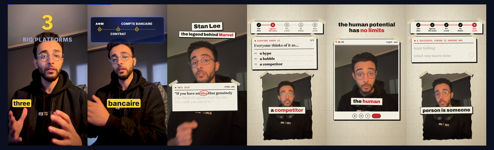
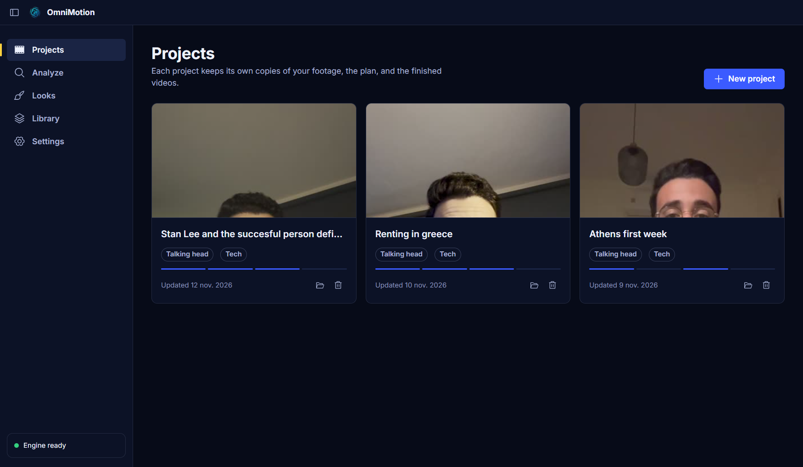
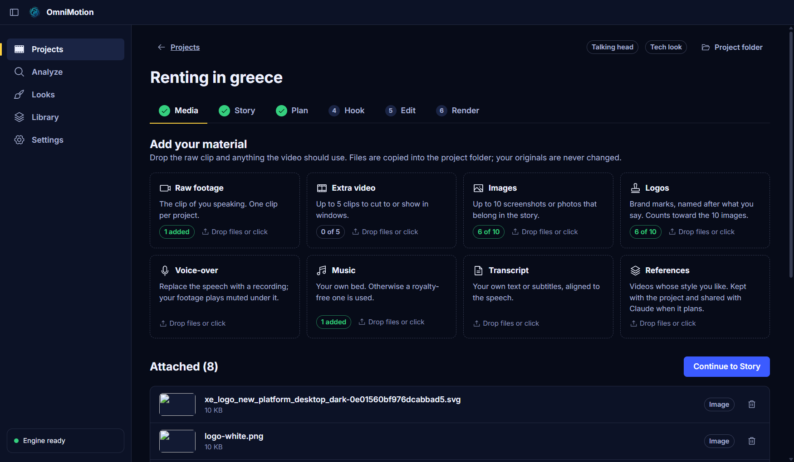
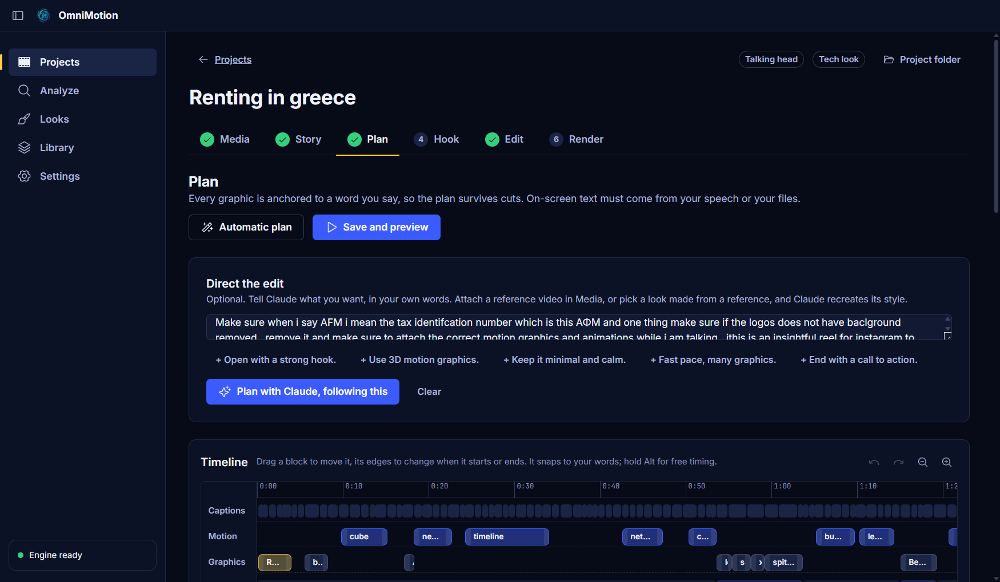
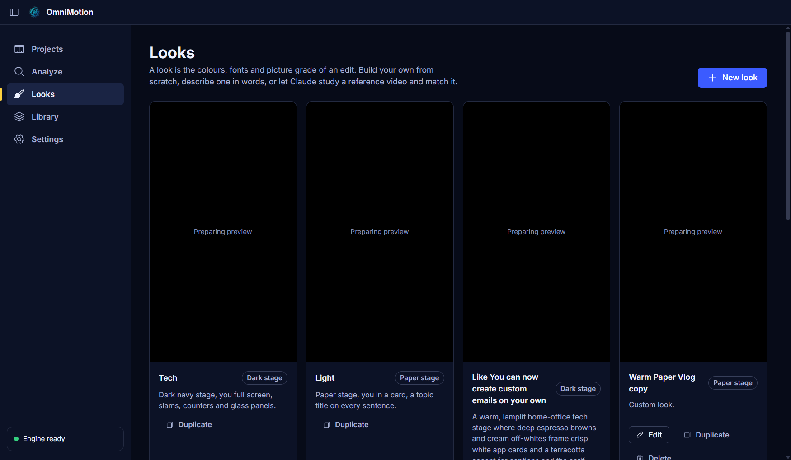
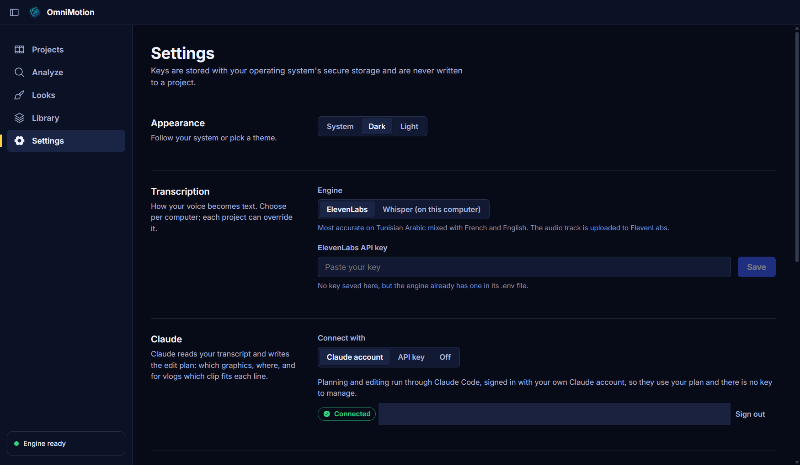

<p align="center">
  
</p>

<h1 align="center">OmniMotion</h1>

<p align="center">
  A desktop editor that turns a raw talking-head clip into a finished short-form video (Reels, TikTok, Shorts):<br/>
  silences cut, word-timed captions, motion graphics, zooms, transitions, sound design and loudness, all from your own words.
</p>

<p align="center">
  
  <br/><sub>Frames from real edits: the built-in Tech look (left) and a paper scrapbook style built on the same engine (right).</sub>
</p>

---

## What it does

- **Cuts the pauses, never the words.** Pauses longer than about 0.35 s are shortened; every spoken word stays.
- **Transcribes mixed languages.** Arabic (including Tunisian), French and English in one sentence, with ElevenLabs Scribe or offline with Whisper.
- **Plans the edit from what you say.** Every caption, card, chart and motion graphic is anchored to a spoken word, so on-screen text always comes from your speech or your own files.
- **Plan with Claude.** Optionally let Claude (through Claude Code or an API key) write the plan, or change it in plain words: *"remove the last graphic"*, *"zoom in when I say Greece"*. Every change can be undone.
- **Looks.** Colours, fonts and picture grade on a dark or paper stage. Build your own from scratch, from a description, or from a reference video.
- **Finishes the sound.** Royalty-free music that ducks under your voice, sound effects on every visual event, and a mix to -14 LUFS (true peak under -1 dBTP), the level Instagram, TikTok and YouTube expect.
- **Live preview.** A Remotion player shows the exact composition that gets rendered.

## Screenshots

| Projects | Media |
|---|---|
|  |  |
| **Story** (transcribe and cut) | **Plan** (timeline anchored to words) |
|  |  |
| **Edit** (change the plan in plain words) | **Render** |
|  |  |
| **Looks** | **Settings** |
|  |  |

---

## Install

### Option A: Windows installer (easiest)

1. Open the [**Releases**](../../releases) page and download `OmniMotion-Setup-0.1.0.exe`.
2. Run it. Windows SmartScreen may warn because the app is not code-signed yet: click **More info → Run anyway**.
3. Start **OmniMotion** from the desktop shortcut.

The installer already contains the editing engine and FFmpeg, so nothing else is required. Then do the [first-run setup](#first-run-setup).

### Option B: run from source (Windows, macOS, Linux)

**You need**

| Tool | Version | Why |
|---|---|---|
| [Node.js](https://nodejs.org) | 20.19+ or 22.13+ (24 works) | runs the app and the engine |
| [FFmpeg](https://ffmpeg.org/download.html) | any recent full build, on your `PATH` | cutting, mixing, loudness |
| [Git](https://git-scm.com) | any | to clone the repo |
| Google Chrome or Microsoft Edge | any | screenshots of web pages used as graphics (optional) |

Check FFmpeg is found:

```bash
ffmpeg -version
```

**1. Clone**

```bash
git clone https://github.com/Mjawadi2002/OmniMotion.git
cd OmniMotion
```

The two folders must stay side by side: the app (`cutline-app/`) looks for the engine in `../video-studio`.

**2. Install the engine**

```bash
cd video-studio
npm install
cd ..
```

**3. Install and start the app**

```bash
cd cutline-app
npm install
npm start
```

`npm start` builds the interface and opens the window. For development with hot reload use `npm run dev`.

**4. (Optional) Build your own installer**

```bash
cd cutline-app
npm run dist
```

The installer lands in `cutline-app/release/`. It packs the engine and the FFmpeg it finds on your `PATH` (or in the folder set in `OMNIMOTION_FFMPEG_DIR`).

---

## First-run setup

Open **Settings** in the app.

1. **Engine**: should show *Engine ready*. If not, point it at the `video-studio` folder.
2. **Transcription** (pick one):
   - **ElevenLabs** (best for mixed Arabic / French / English): paste your API key. It is stored in your operating system's secure storage, never in a project file.
   - **Whisper (offline, free)**: download the model once from the `video-studio` folder:
     ```bash
     cd video-studio
     node -e "const w=require('@remotion/install-whisper-cpp');(async()=>{await w.installWhisperCpp({to:'whisper.cpp',version:'1.5.5'});await w.downloadWhisperModel({model:'small',folder:'whisper.cpp'});})()"
     ```
3. **Claude** (optional, for *Plan with Claude*, the Edit tab and Looks from references):
   - **Claude account**: install [Claude Code](https://docs.claude.com/en/docs/claude-code) and sign in once; OmniMotion uses it with your own account.
   - **API key**: paste an Anthropic API key.
   - **Off**: the automatic planner still works without AI.
4. **Pop-out head** (optional, light looks): needs Python 3 with `pip install onnxruntime pillow numpy` and the `u2net_human_seg.onnx` model (from the [rembg releases](https://github.com/danielgatis/rembg/releases)) saved as `video-studio/models/u2net_human_seg.onnx`.

## How to edit a video

1. **Projects → New project**: choose *Talking head* or *Vlog*, and a look.
2. **Media**: drop your raw clip. Add logos, screenshots, extra clips, music or reference videos if you have them. Files are copied into the project; your originals are never changed.
3. **Story**: click **Transcribe and cut**. You get the transcript with timestamps and the silence cuts.
4. **Plan**: click **Automatic plan**, or describe what you want and click **Plan with Claude**. Drag blocks on the timeline; they snap to your words.
5. **Edit** (optional): type changes in plain words and watch the preview rebuild.
6. **Render**: pick music, sound effects and look, then **Render video**. The video and an edit report land in the project's `output/` folder.

## Project layout

```
cutline-app/        the desktop app (Electron + React + Remotion Player)
  electron/         main process: projects, engine runner, media server, AI planning
  src/              interface: screens, design tokens, live preview
video-studio/       the editing engine
  .claude/skills/edit-style/
    scripts/        director.mjs (prepare, plan, render), transcription, assets, sound design
    remotion/       the Remotion compositions that draw the video
    docs/           plan schema, motion graphics and sound design guides
    assets/cc0/     CC0 music and sound effects (sources in THIRD_PARTY.md)
docs/               screenshots and images for this README
```

Command-line use of the engine (without the app) is documented in `video-studio/.claude/skills/edit-style/docs/DIRECTOR.md`.

## Troubleshooting

- **"Engine not found"**: keep `cutline-app` and `video-studio` in the same parent folder, or set the engine path in Settings.
- **FFmpeg errors** about a missing filter: install a full FFmpeg build (the one bundled inside Remotion lacks some filters).
- **No transcription key**: without an ElevenLabs key the engine falls back to Whisper; install the Whisper model as shown above.
- **Render is slow**: lower *Render workers* in the Render tab if your computer struggles, raise it on a strong CPU.

## Privacy and security

- API keys are encrypted with your OS keychain and never written into a project or this repo.
- Media is served to the window from a local server bound to `127.0.0.1` with a per-launch token.
- When ElevenLabs is selected, only the 16 kHz audio track is uploaded for transcription. Whisper runs fully offline.

## Credits

Built with [Electron](https://www.electronjs.org), [React](https://react.dev), [Remotion](https://www.remotion.dev), [FFmpeg](https://ffmpeg.org), [Phosphor Icons](https://phosphoricons.com) and fonts from [Fontsource](https://fontsource.org). Music and sound effects are CC0; see `video-studio/.claude/skills/edit-style/assets/cc0/THIRD_PARTY.md`.

Remotion is free for individuals and small teams; larger companies need a [Remotion company license](https://www.remotion.dev/license).
